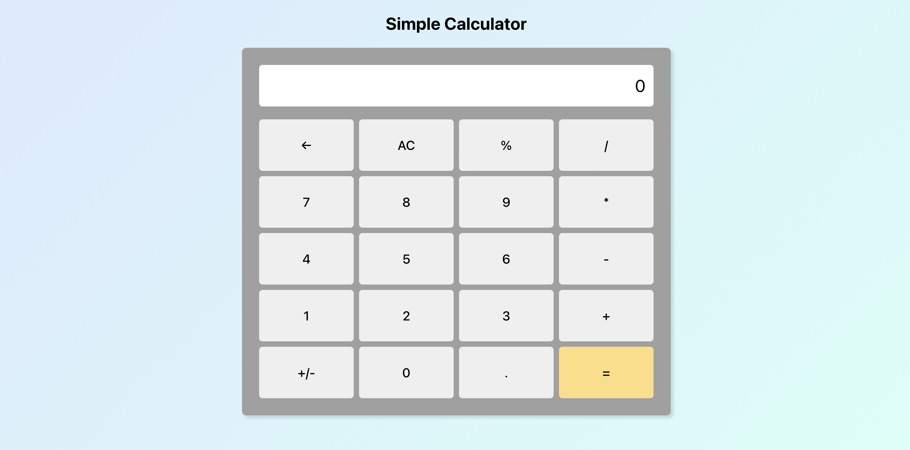

# Vanilla JS Calculator"
Calculator built with HTML, CSS, and Vanilla JS.

LIVE DEMO: https://alanatm.github.io/calculator/

About the project:
A fully functional, interactive web calculator built with pure JavaScript. This project focuses on clean code practices, robust state validation, and a modular architecture, demonstrating core programming concepts without relying on external libraries or frameworks.

Tech Stack:

* **HTML5:** Semantic structure.
* **CSS3:** 
  * **CSS Grid** for a responsive and precise button layout.
  * **BEM Methodology** (Block Element Modifier) for scalable, maintainable, and readable CSS classes.
* **JavaScript (ES6+):** Vanilla JS for DOM manipulation and dynamic event handling using `data-attributes`.